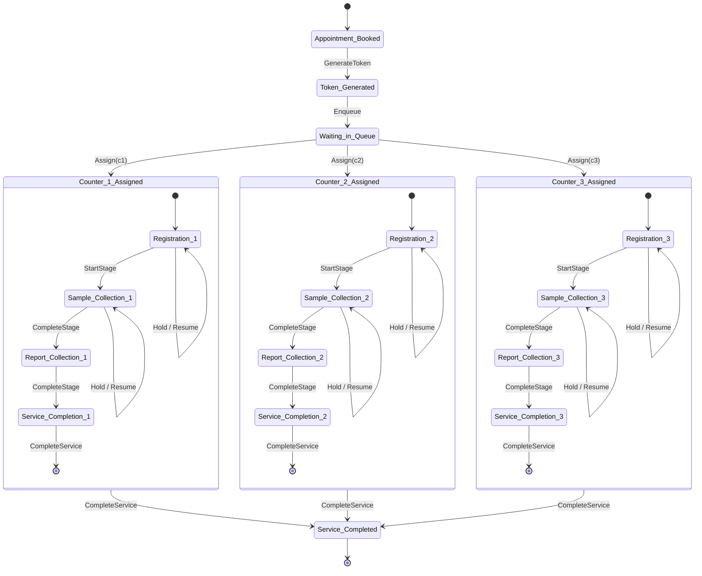

# QueueLess AI — Problem Formulation and State Space

## 1. Scope

QueueLess AI models a diagnostic-laboratory customer as a planning problem over three parallel service counters. The planner selects valid service actions, assigns a counter, and minimizes accumulated waiting, service, and transition cost while preserving stage order.

## 2. PEAS Task Environment

| PEAS element | QueueLess AI specification |
|---|---|
| **Performance measure** | Minimize customer waiting time, service completion time, counter idle time, and invalid transitions; maximize throughput, fairness, and successful completion rate. |
| **Environment** | A diagnostic laboratory with appointment intake, token generation, one waiting queue, three counters \(c_1,c_2,c_3\), and ordered service stages. |
| **Actuators** | Book appointment, generate token, enqueue token, assign counter, start stage, hold/resume service, transfer counter, complete stage, and complete service. |
| **Sensors** | Appointment and token records, queue order, token stage, counter availability, estimated service duration, waiting time, and transition history. |

### Environment Property Classification

| Property | Classification | Basis |
|---|---|---|
| Observability | **Observable** | The planner receives the queue, token state, counter state, service durations, and recorded transitions required for its decisions. |
| Predictability | **Deterministic** | Given the same state, action, transition policy, and stored durations, `Result(s, a)` produces the same next state. External delay is represented by explicit state updates. |
| Temporal structure | **Sequential** | Each action changes the state and affects the available actions and costs of later stages. |
| Change during deliberation | **Semi-Dynamic** | The model does not change while an action is being selected, but waiting time and counter availability change as simulated service time advances. |
| State/action representation | **Discrete** | Tokens, stages, counters, actions, and transitions are represented as finite symbolic values. Durations and costs are numeric attributes of those values. |

## 3. Formal Problem Formulation

The diagnostic service problem is the 6-tuple

$$
\mathcal{P} = (S, s_0, S_G, A, T, c).
$$

### 3.1 State Set

For one token, the principal service states are:

$$
\begin{aligned}
S_1 &= \text{Appointment Booked},\\
S_2 &= \text{Token Generated},\\
S_3 &= \text{Waiting in Queue},\\
S_4(c_i) &= \text{Counter Assigned to }c_i,\quad i\in\{1,2,3\},\\
S_5(c_i) &= \text{Service In Progress at }c_i,\quad i\in\{1,2,3\},\\
S_6 &= \text{Service Completed}.
\end{aligned}
$$

A concrete planning state also records the token identifier, current laboratory stage, queue position, counter availability, accumulated cost, and event time:

$$
s = (\text{token}, \text{stage}, \text{status}, \text{counter}, \text{queue}, \text{availability}, t).
$$

The state set \(S\) contains all valid combinations of these fields. Invalid combinations, such as a completed token assigned to a counter, are excluded.

### 3.2 Initial and Goal States

For an appointment that has been checked in:

$$
s_0 \in S_3
$$

with the token in the queue at stage `Registration`. The goal set is:

$$
S_G = \{s\in S \mid \text{status}(s)=S_6
\land \text{stage}(s)=\text{Service Completion}\}.
$$

An un-checked-in appointment begins at \(S_1\); token generation produces \(S_2\), and queue insertion produces \(S_3\).

### 3.3 Action Set

The action set includes:

$$
\begin{aligned}
A=\{&
\text{BookAppointment},\text{GenerateToken},\text{Enqueue},\\
&\text{Assign}(c_i),\text{StartStage}(k,c_i),\text{Hold},\text{Resume},\\
&\text{Transfer}(c_i,c_j),\text{CompleteStage},\text{CompleteService}\}.
\end{aligned}
$$

An action is enabled only when its preconditions hold. For example, `Assign(\(c_i\))` requires \(c_i\) to be available and the token to be in \(S_3\); `StartStage(\(k,c_i\))` requires the token to be in \(S_4(c_i)\) and stage \(k\) to be ready.

### 3.4 Transition Rules

The deterministic transition function is:

$$
T(s,a)=\operatorname{Result}(s,a)=
\begin{cases}
S_2 & s=S_1,\ a=\text{GenerateToken},\\
S_3 & s=S_2,\ a=\text{Enqueue},\\
S_4(c_i) & s=S_3,\ a=\text{Assign}(c_i),\\
S_5(c_i) & s=S_4(c_i),\ a=\text{StartStage}(k,c_i),\\
S_4(c_i) & s=S_5(c_i),\ a=\text{CompleteStage and more stages remain},\\
S_6 & s=S_5(c_i),\ a=\text{CompleteService},\\
\text{undefined} & \text{otherwise}.
\end{cases}
$$

The stage order is `Registration` \(\rightarrow\) `Sample Collection` \(\rightarrow\) `Report Collection` \(\rightarrow\) `Service Completion`. A hold action preserves the current stage and changes the status to held; resume returns the token to the assigned counter's active state. A transfer changes \(c_i\) to \(c_j\) only when \(c_j\) is available.

### 3.5 Step Cost

For an enabled transition involving counter \(c_i\):

$$
c(s,a,s') =
W_{\text{wait}}(c_i)
+D_{\text{service}}(\text{stage},c_i)
+\tau_{\text{transition}}(s,s').
$$

For non-service actions, \(D_{\text{service}}\) is zero. All costs are non-negative. \(W_{\text{wait}}\) is calculated from queue position and aging; \(D_{\text{service}}\) is the estimated duration for the stage and counter; and \(\tau_{\text{transition}}\) is the fixed or measured handoff cost.

## 4. State-Space Diagram

## 5. Counter Comparison

For a token at the same queue position and stage, assume equal transition cost \(\tau=1\) minute and zero difference in priority wait cost. The estimated completion cost is therefore dominated by service duration:

| Counter | Estimated service duration | Transition cost | Total estimated step cost | Decision |
|---|---:|---:|---:|---|
| Counter 1 (\(c_1\)) | 15 min | 1 min | 16 min | Not selected |
| Counter 2 (\(c_2\)) | 12 min | 1 min | 13 min | Not selected |
| Counter 3 (\(c_3\)) | 10 min | 1 min | 11 min | Selected |

Counter 3 is selected because it has the minimum estimated cost. A real decision must recompute \(W_{\text{wait}}\), availability, and stage-specific duration before assignment.
