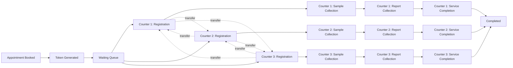

# QueueLess AI — Graph and Dictionary Specification

## 1. Weighted Directed State Graph

The diagnostic workflow is represented as a weighted directed graph:

$$
G=(V,E,W),
$$

where \(V\) is the set of state nodes, \(E\subseteq V\times V\) is the set of permitted directed transitions, and

$$
W:E\rightarrow\mathbb{R}_{\geq 0}
$$

assigns a non-negative cost to every transition.

For an edge \(e=(u,v)\), the weight is:

$$
W(u,v)=W_{\text{wait}}(c_i)+D_{\text{service}}(k,c_i)+\tau_{\text{transition}}(u,v).
$$

The graph is directed because a laboratory handoff is not necessarily reversible. For example, report collection may return to sample collection only through an explicit correction or rework edge.

## 2. Node Taxonomy

| Node class | Examples | Purpose |
|---|---|---|
| Intake nodes | `appointment_booked`, `token_generated`, `waiting_queue` | Represent pre-counter customer state. |
| Stage nodes | `registration`, `sample_collection`, `report_collection`, `service_completion` | Represent ordered laboratory work. |
| Counter nodes | `counter_1`, `counter_2`, `counter_3` | Represent assignment alternatives and availability. |
| Counter-stage nodes | `counter_1.registration`, `counter_2.sample_collection` | Represent a stage being performed at a particular counter. |
| Terminal nodes | `completed`, `cancelled` | Represent final outcomes. |

## 3. Edge Transition Rules

1. `appointment_booked -> token_generated` is enabled after token validation.
2. `token_generated -> waiting_queue` is enabled after enqueue.
3. `waiting_queue -> counter_i.registration` is enabled only if counter \(i\) is available.
4. A stage node may advance only to the next permitted stage.
5. A counter-stage node may transfer to the same stage at another available counter.
6. `service_completion -> completed` is enabled only after all required stages finish.
7. Hold/resume is represented as a self-loop with explicit state metadata, not as progress to the next stage.
8. Every edge must have a non-negative weight and a recorded action label.

## 4. Diagnostic Laboratory Graph



## 5. Python Adjacency Dictionary Schema

The following representation is runnable Python. Each outgoing edge is represented by a dictionary containing the destination, action, and current weight.

```python
from __future__ import annotations

from dataclasses import dataclass
from typing import Dict, List


@dataclass(frozen=True)
class Edge:
    target: str
    action: str
    weight: float


service_graph: Dict[str, List[Edge]] = {
    "appointment_booked": [
        Edge("token_generated", "generate_token", 0.1),
    ],
    "token_generated": [
        Edge("waiting_queue", "enqueue", 0.1),
    ],
    "waiting_queue": [
        Edge("counter_1.registration", "assign_counter_1", 15.0),
        Edge("counter_2.registration", "assign_counter_2", 12.0),
        Edge("counter_3.registration", "assign_counter_3", 10.0),
    ],
    "counter_1.registration": [
        Edge("counter_1.sample_collection", "complete_registration", 6.0),
    ],
    "counter_1.sample_collection": [
        Edge("counter_1.report_collection", "complete_sample_collection", 9.0),
    ],
    "counter_1.report_collection": [
        Edge("counter_1.service_completion", "complete_report_collection", 3.0),
    ],
    "counter_1.service_completion": [
        Edge("completed", "complete_service", 1.0),
    ],
    "counter_2.registration": [
        Edge("counter_2.sample_collection", "complete_registration", 5.0),
    ],
    "counter_2.sample_collection": [
        Edge("counter_2.report_collection", "complete_sample_collection", 8.0),
    ],
    "counter_2.report_collection": [
        Edge("counter_2.service_completion", "complete_report_collection", 3.0),
    ],
    "counter_2.service_completion": [
        Edge("completed", "complete_service", 1.0),
    ],
    "counter_3.registration": [
        Edge("counter_3.sample_collection", "complete_registration", 4.0),
    ],
    "counter_3.sample_collection": [
        Edge("counter_3.report_collection", "complete_sample_collection", 7.0),
    ],
    "counter_3.report_collection": [
        Edge("counter_3.service_completion", "complete_report_collection", 2.0),
    ],
    "counter_3.service_completion": [
        Edge("completed", "complete_service", 1.0),
    ],
    "completed": [],
}
```

## 6. Expanded Counter-Aware State Graph

The expanded graph makes counter identity explicit and supports dynamic weights:

```python
from dataclasses import dataclass
from typing import Dict, List


@dataclass(frozen=True)
class Edge:
    target: str
    action: str
    weight: float


COUNTERS = ("counter_1", "counter_2", "counter_3")
STAGES = ("registration", "sample_collection", "report_collection")


def node(counter: str, stage: str) -> str:
    return f"{counter}.{stage}"


def build_state_graph(
    service_duration: Dict[str, Dict[str, float]],
    wait_minutes: Dict[str, float],
    transition_minutes: float = 1.0,
) -> Dict[str, List[Edge]]:
    graph: Dict[str, List[Edge]] = {"waiting_queue": []}
    for counter in COUNTERS:
        graph["waiting_queue"].append(
            Edge(
                node(counter, STAGES[0]),
                f"assign_{counter}",
                wait_minutes[counter]
                + service_duration[counter][STAGES[0]]
                + transition_minutes,
            )
        )
        for index, stage in enumerate(STAGES):
            current = node(counter, stage)
            graph.setdefault(current, [])
            if index + 1 < len(STAGES):
                next_stage = node(counter, STAGES[index + 1])
                graph[current].append(
                    Edge(
                        next_stage,
                        f"complete_{stage}",
                        service_duration[counter][STAGES[index + 1]]
                        + transition_minutes,
                    )
                )
            else:
                graph[current].append(
                    Edge("service_completion", "complete_service", transition_minutes)
                )
            for other_counter in COUNTERS:
                if other_counter != counter:
                    graph[current].append(
                        Edge(
                            node(other_counter, stage),
                            f"transfer_to_{other_counter}",
                            transition_minutes,
                        )
                    )
    graph["service_completion"] = []
    return graph


durations = {
    "counter_1": {"registration": 5.0, "sample_collection": 8.0, "report_collection": 2.0},
    "counter_2": {"registration": 4.0, "sample_collection": 7.0, "report_collection": 2.0},
    "counter_3": {"registration": 3.0, "sample_collection": 6.0, "report_collection": 1.0},
}
wait = {"counter_1": 15.0, "counter_2": 12.0, "counter_3": 10.0}
expanded_state_graph = build_state_graph(durations, wait)
```

## 7. Dynamic Weight Recalculation

Weights are recalculated before every assignment or search:

$$
W_t(u,v)=W_{\text{wait},t}(c_i)
+D_{\text{service},t}(k,c_i)
+\tau_{\text{transition},t}(u,v).
$$

The implementation shall:

1. Re-read queue position and aging time to update \(W_{\text{wait},t}\).
2. Exclude unavailable counters from assignment edges.
3. Re-read stage-specific duration estimates.
4. Add transfer or handoff cost when the action is a transfer.
5. Reject negative weights before UCS or $A^*$.
6. Rebuild or update the affected adjacency lists atomically so a search sees one consistent snapshot.
