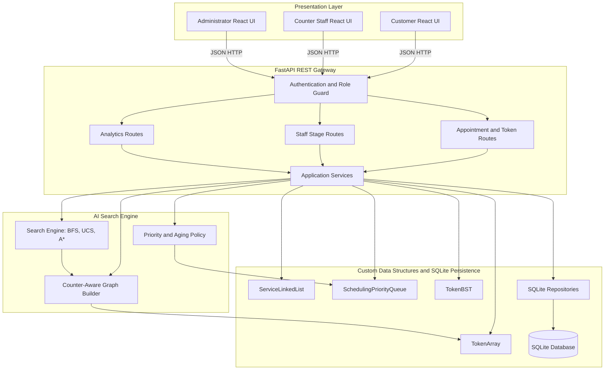

# QueueLess AI — System Architecture and Components

## 1. Architectural Overview

QueueLess AI uses four tiers with explicit dependency direction:

1. **Presentation Layer:** React, Vite, and Tailwind CSS render customer, counter staff, and administrator views.
2. **FastAPI REST Gateway:** validates requests, authenticates roles, exposes JSON endpoints, and coordinates transactions.
3. **AI Search Engine:** builds counter-aware state graphs and runs BFS, UCS, or $A^*$ for routing and scheduling decisions.
4. **Custom Data Structures and SQLite Persistence Layer:** maintains runtime indexes/queues and durable records.

Dependencies point downward. The presentation layer never imports `backend/ds`; the AI engine never writes SQLite directly; and persistence does not call HTTP handlers.

## 2. Component-Based Architecture

## 3. Module Boundary Rules

| Boundary | Required rule |
|---|---|
| UI to gateway | Use versioned JSON endpoints; do not expose internal nodes or SQLite rows directly. |
| Gateway to services | Handlers validate input and authorization, then delegate one application operation. |
| Services to AI | Pass immutable state snapshots; receive route, cost, and expansion metadata. |
| Services to data structures | Use ADT interfaces; do not access internal array indices, node pointers, or heap storage. |
| AI to persistence | No direct database access; graph construction receives repository data through a service. |
| Persistence to SQLite | Use parameterized SQL and transactions; repositories map rows to domain records. |
| Cross-tier errors | Raise typed domain errors and map them to explicit HTTP responses; do not silently return success-shaped fallbacks. |

## 4. REST API Endpoint Specification

| Method | Endpoint | Role | Request/response responsibility |
|---|---|---|---|
| `POST` | `/api/v1/appointments` | Customer, Staff, Administrator | Create appointment; return appointment reference. |
| `POST` | `/api/v1/tokens` | Customer, Staff, Administrator | Generate a `Q101`-`Q999` token and enqueue it. |
| `POST` | `/api/v1/appointments/{id}/check-in` | Customer, Staff | Convert an appointment into an active queue token. |
| `GET` | `/api/v1/tokens/{token_id}` | Public authenticated lookup | Return token state, stage, counter, and estimate. |
| `GET` | `/api/v1/queue` | Customer, Staff, Administrator | Return public or authorized queue status. |
| `POST` | `/api/v1/queue/assign` | Staff, Administrator | Run counter assignment and persist the result. |
| `POST` | `/api/v1/tokens/{token_id}/transition` | Counter Staff | Validate and record a stage transition. |
| `POST` | `/api/v1/tokens/{token_id}/transfer` | Counter Staff, Administrator | Atomically transfer an eligible token. |
| `POST` | `/api/v1/tokens/{token_id}/hold` | Counter Staff, Administrator | Hold or resume service. |
| `GET` | `/api/v1/analytics` | Administrator | Return aggregate throughput, wait, and utilization metrics. |
| `GET` | `/api/v1/health` | Public | Return service and schema readiness. |

All mutating endpoints use transaction boundaries and return an event identifier for audit correlation.
