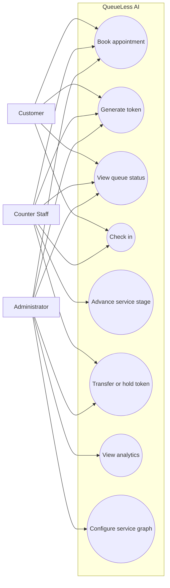
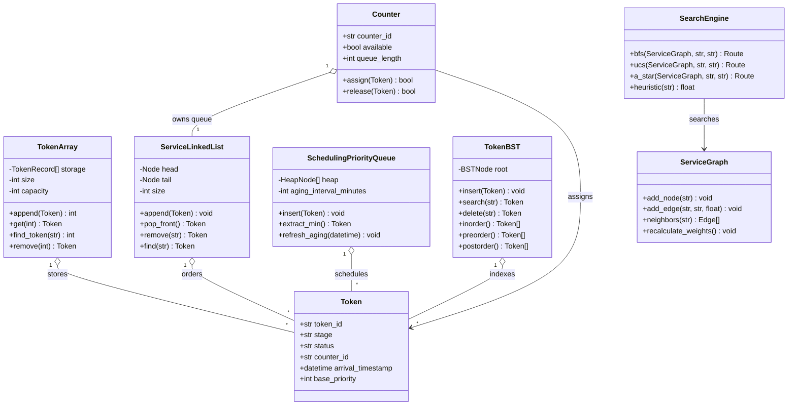
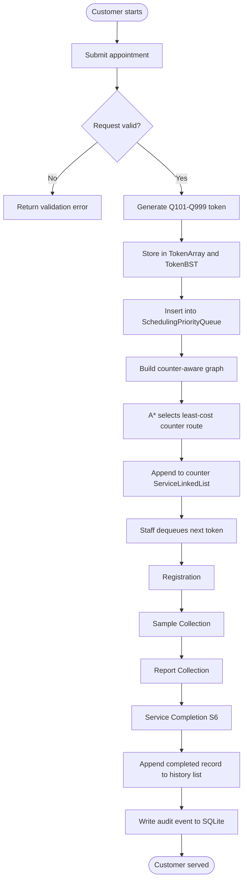
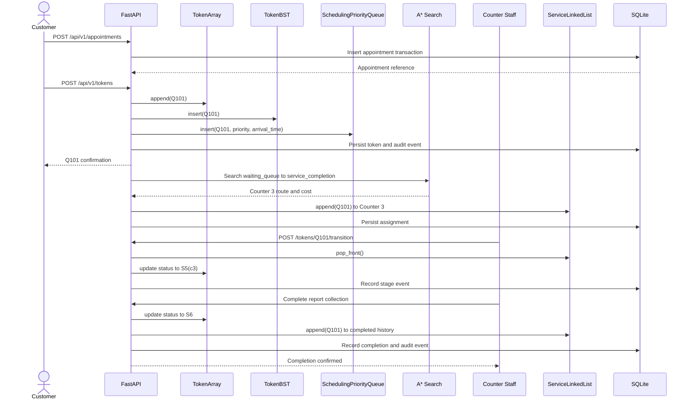

# QueueLess AI — UML, Operational Flow, and Call Flow

## 1. Use Case Diagram

Customers control their appointment and status interactions. Staff control operational transitions. Administrators control aggregate analysis and configuration.

## 2. Class Diagram

The classes expose abstract operations rather than their internal storage. `SearchEngine` consumes a graph snapshot and returns a route; it does not mutate the data structures.

## 3. System Operational Flowchart

The rejection branch terminates before any active token or queue structure is mutated.

## 4. End-to-End Call Flow

The API is the transaction boundary: in-memory updates and the corresponding SQLite event must either both succeed or both be rolled back.
