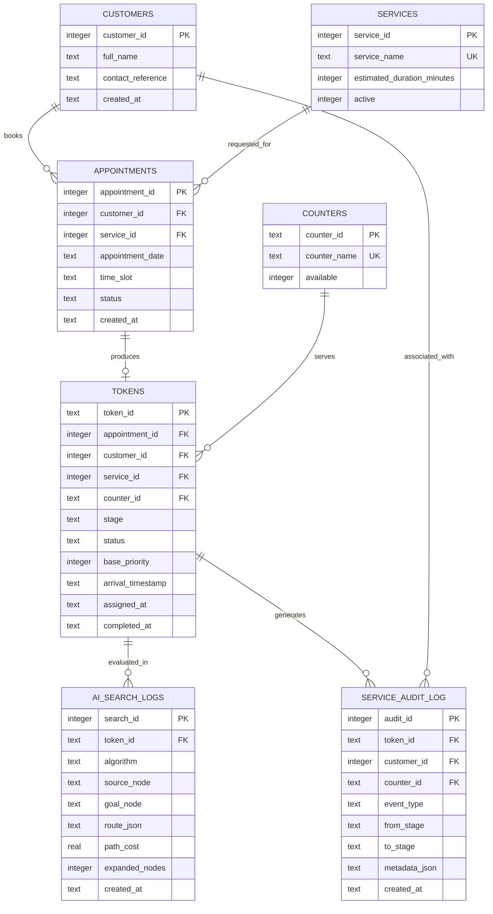

# QueueLess AI — ER Diagram and SQLite Schema

## 1. Entity-Relationship Diagram



## 2. Complete SQLite DDL

```sql
PRAGMA foreign_keys = ON;

CREATE TABLE IF NOT EXISTS customers (
    customer_id INTEGER PRIMARY KEY,
    full_name TEXT NOT NULL CHECK (length(trim(full_name)) > 0),
    contact_reference TEXT,
    created_at TEXT NOT NULL DEFAULT CURRENT_TIMESTAMP
);

CREATE TABLE IF NOT EXISTS services (
    service_id INTEGER PRIMARY KEY,
    service_name TEXT NOT NULL UNIQUE,
    estimated_duration_minutes INTEGER NOT NULL
        CHECK (estimated_duration_minutes > 0),
    active INTEGER NOT NULL DEFAULT 1 CHECK (active IN (0, 1))
);

CREATE TABLE IF NOT EXISTS counters (
    counter_id TEXT PRIMARY KEY
        CHECK (counter_id IN ('counter_1', 'counter_2', 'counter_3')),
    counter_name TEXT NOT NULL UNIQUE,
    available INTEGER NOT NULL DEFAULT 1 CHECK (available IN (0, 1))
);

CREATE TABLE IF NOT EXISTS appointments (
    appointment_id INTEGER PRIMARY KEY,
    customer_id INTEGER NOT NULL REFERENCES customers(customer_id),
    service_id INTEGER NOT NULL REFERENCES services(service_id),
    appointment_date TEXT NOT NULL,
    time_slot TEXT NOT NULL,
    status TEXT NOT NULL CHECK (
        status IN ('booked', 'checked_in', 'completed', 'cancelled')
    ),
    created_at TEXT NOT NULL DEFAULT CURRENT_TIMESTAMP,
    UNIQUE (customer_id, appointment_date, time_slot)
);

CREATE TABLE IF NOT EXISTS tokens (
    token_id TEXT PRIMARY KEY CHECK (
        token_id GLOB 'Q[1-9][0-9][0-9]'
        AND CAST(substr(token_id, 2) AS INTEGER) BETWEEN 101 AND 999
    ),
    appointment_id INTEGER UNIQUE REFERENCES appointments(appointment_id),
    customer_id INTEGER NOT NULL REFERENCES customers(customer_id),
    service_id INTEGER NOT NULL REFERENCES services(service_id),
    counter_id TEXT REFERENCES counters(counter_id),
    stage TEXT NOT NULL CHECK (
        stage IN (
            'registration',
            'sample_collection',
            'report_collection',
            'service_completion'
        )
    ),
    status TEXT NOT NULL CHECK (
        status IN ('waiting', 'assigned', 'in_service', 'held', 'completed', 'cancelled')
    ),
    base_priority INTEGER NOT NULL DEFAULT 0,
    arrival_timestamp TEXT NOT NULL,
    assigned_at TEXT,
    completed_at TEXT
);

CREATE TABLE IF NOT EXISTS ai_search_logs (
    search_id INTEGER PRIMARY KEY,
    token_id TEXT NOT NULL REFERENCES tokens(token_id),
    algorithm TEXT NOT NULL CHECK (algorithm IN ('BFS', 'UCS', 'A_STAR')),
    source_node TEXT NOT NULL,
    goal_node TEXT NOT NULL,
    route_json TEXT NOT NULL,
    path_cost REAL NOT NULL CHECK (path_cost >= 0),
    expanded_nodes INTEGER NOT NULL CHECK (expanded_nodes >= 0),
    created_at TEXT NOT NULL DEFAULT CURRENT_TIMESTAMP
);

CREATE TABLE IF NOT EXISTS service_audit_log (
    audit_id INTEGER PRIMARY KEY,
    token_id TEXT NOT NULL REFERENCES tokens(token_id),
    customer_id INTEGER NOT NULL REFERENCES customers(customer_id),
    counter_id TEXT REFERENCES counters(counter_id),
    event_type TEXT NOT NULL,
    from_stage TEXT,
    to_stage TEXT,
    metadata_json TEXT NOT NULL DEFAULT '{}',
    created_at TEXT NOT NULL DEFAULT CURRENT_TIMESTAMP
);

CREATE INDEX IF NOT EXISTS idx_appointments_date_status
    ON appointments (appointment_date, status);
CREATE INDEX IF NOT EXISTS idx_tokens_status_arrival
    ON tokens (status, arrival_timestamp);
CREATE INDEX IF NOT EXISTS idx_tokens_counter_status
    ON tokens (counter_id, status);
CREATE INDEX IF NOT EXISTS idx_ai_logs_token_created
    ON ai_search_logs (token_id, created_at);
CREATE INDEX IF NOT EXISTS idx_audit_token_created
    ON service_audit_log (token_id, created_at);
```

## 3. Startup Hydration Rules

SQLite is the authoritative state store. Startup must complete schema migration and validation before accepting requests.

1. Enable foreign keys and open the database in a transaction-safe mode.
2. Load the three counter rows and construct exactly three `Counter` records.
3. Load all non-cancelled tokens ordered by `arrival_timestamp`, then `token_id`.
4. Append each active token to `TokenArray`; insert it into `TokenBST`.
5. For tokens with status `waiting`, compute effective priority using the current time and insert them into `SchedulingPriorityQueue`.
6. For tokens with status `assigned`, `in_service`, or `held`, append them to the linked list belonging to `counter_id`, ordered by assignment time and arrival time.
7. Load completed tokens ordered by `completed_at`, and append them to the completed-service history `ServiceLinkedList`.
8. Rebuild the counter-aware graph from active service durations and current counter availability.
9. Ignore `ai_search_logs` for queue ordering; they are historical evidence, not authoritative state.
10. If a token references an unavailable counter, duplicate active token, missing service, or invalid status transition, fail startup explicitly and report the inconsistent records.

Hydration is idempotent: clearing runtime structures and replaying the same ordered query results produces the same indexes and queue order. Mutating operations update SQLite and in-memory structures within one application transaction; a failed operation must not leave a structure partially updated.
